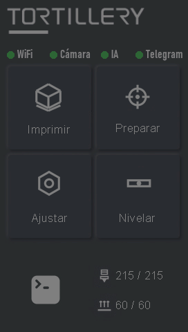

<div align="center">


# Tortillery+

**Klipper, Mainsail y una pantalla táctil nueva para la Artillery Sidewinder X4 Pro y X4 Plus**

[](https://github.com/tecxion/tortillery-plus/tags)


[Descargar](#-descarga) · [Instalar](#-instalación) · [SSH](#-conectarse-por-ssh) · [Preguntas](#-preguntas-frecuentes) · [Problemas](#-problemas-comunes) · [Novedades](tortillery_plus/CAMBIOS.md) · [Guía completa](tortillery_plus/README.md)

</div>

---

Grabas la imagen, enciendes la impresora y la pantalla te guía: **modelo, idioma, WiFi y nivelación**. Sin SSH, sin
editar archivos y conservando tu calibración en cada actualización.

## ✨ Qué trae

|                           |                                                                                                                         |
| ------------------------- | ----------------------------------------------------------------------------------------------------------------------- |
| 🖥️ **Pantalla nueva**     | WiFi desde la pantalla, explorador por carpetas con USB, tiempo restante real, errores en español y calibración guiada. |
| 🎯 **Calibración guiada** | Input shaper con aceleración máxima, pressure advance, extrusor y torsión del eje X, todo desde la pantalla.            |
| ⚡ **Corte de luz**       | Guarda el estado cada 5 s y al volver ofrece reanudar la impresión.                                                     |
| 📷 **Cámara automática**  | Cualquier webcam USB aparece en Mainsail sin configurar nada.                                                           |
| 🤖 **Vigilancia con IA**  | Detecta espagueti, piezas despegadas y atascos; pausa y te avisa con foto (Anthropic, OpenAI, Google, NVIDIA u Ollama). |
| 💬 **Telegram**           | Inicio, pausa con botones, fin con foto, vídeo del timelapse y aviso de mantenimiento. `/foto`, `/estado`, `/reanudar`. |
| 🔄 **Actualizaciones**    | Desde Mainsail con un clic (solo versiones estables, nunca imprimiendo) y USB firmado para pantalla y placa.            |
| 🛡️ **Más segura**         | Apagado de calentadores en pausas largas, detección de termistor suelto, watchdog y copias automáticas de la config.    |

Lista completa de cambios respecto a la Tortillery original: **[CAMBIOS.md](tortillery_plus/CAMBIOS.md)**.

## 📱 La pantalla

<div align="center">

</div>

<sub>Menú principal con la barra de estado, calibración guiada, luz LED, malla con 5x5 a 9x9 puntos, utilidades y color
a medida.</sub>

## 💬 Avisos en Telegram

<table>
<tr>
<td width="55%">

</td>
<td>

La impresora te escribe por Telegram:

- ▶️ **Inicio** y ⏹️ **cancelación**, también si cancelas desde la pantalla.
- ⏸️ **Pausa con foto** y botones: _Reanudar_, _Cancelar_ y _Otra foto_.
- ✅ **Fin con foto** y el tiempo que ha tardado.
- ⚡ **Corte de luz**: al volver la corriente te dice cuándo se fue, por dónde iba y te deja _Continuar_ o _Descartar_.
- 🤖 Si la IA ve un fallo, pausa y te manda la foto.
- 🎬 Vídeo del timelapse y aviso de mantenimiento.

Órdenes: `/foto`, `/estado`, `/reanudar`, `/cancelar`. Solo obedece a tu chat.

Se configura en `telegram.cfg` desde Mainsail: [cómo hacerlo](tortillery_plus/README.md#telegram).

</td>
</tr>
</table>

## 🤖 Vigilancia con IA

Cada minuto (o lo que elijas) la IA mira la foto de la cámara. Si ve un fallo, **pausa la impresión** y te avisa con la foto.

- Al empezar cada impresión busca la cama en la foto y solo mira esa zona, ampliada: vale **cualquier posición de la
  cámara**.
- Compara cada foto con otra de hace unos minutos, así nota una pieza que se ha movido o un espagueti que crece.
- Antes de pausar puede pedir confirmación a un segundo modelo.
- Proveedores: Anthropic, OpenAI, Google, NVIDIA, Ollama (en tu PC, gratis) o cualquiera compatible con OpenAI.

Ejemplo real con una foto de espagueti (`tortillery-ai.py --test foto.jpg`):

```text
Proveedor nvidia, modelo nvidia/nemotron-3.5-super-vl-120b-a12b
{"fallo": true, "tipo": "espagueti", "confianza": 0.95,
 "motivo": "Exceso de filamento enredado alrededor del objeto impreso."}
```

Con `--test` también se guarda en `ia_prueba.jpg` lo que ha visto la IA, para comprobar que tu cámara encuadra bien.
Se configura en `tortillery_ai.cfg` desde Mainsail: [cómo hacerlo](tortillery_plus/README.md#detección-de-fallos-con-ia-opcional).

## ⚖️ Tortillery y Tortillery+

|                                                | Tortillery original | **Tortillery+** |
| ---------------------------------------------- | :-----------------: | :-------------: |
| Klipper, Moonraker y Mainsail en la eMMC       |         ✅          |       ✅        |
| Instalar sin SSH (asistente en pantalla)       |          —          |       ✅        |
| Claves SSH e identidad propias por impresora   |          —          |       ✅        |
| WiFi desde la pantalla                         |          —          |       ✅        |
| Calibración guiada (input shaper, PA…)         |          —          |       ✅        |
| Malla 5x5 a 9x9 y luz LED a medida             |          —          |       ✅        |
| Vigilancia con IA y Telegram                   |          —          |       ✅        |
| Actualizar desde Mainsail (versiones firmadas) |          —          |       ✅        |
| Apagado de calentadores en pausas largas       |          —          |       ✅        |

## 📦 Descarga

La imagen de la eMMC y el firmware de la pantalla pesan demasiado para GitHub y están en Google Drive:

> **[⬇️ Descargar Tortillery+ (Terabox)](https://1024terabox.com/s/1VxnkAWIMICElKzex2T21og)**

## 🧰 Qué necesitas

- Una **Artillery Sidewinder X4 Pro o X4 Plus**.
- Un **lector de eMMC** (adaptador USB para el módulo eMMC de la placa) para grabar la imagen.
- Un **pendrive FAT32**, solo para actualizar la pantalla y el firmware de la placa.
- Opcional: una **webcam USB** (cualquiera UVC) para fotos, timelapse y la IA.
- Opcional: una **clave de API** de IA (u Ollama en tu PC) y un **bot de Telegram** creado con
  [@BotFather](https://t.me/BotFather).

## 🚀 Instalación



1. **Graba la imagen** en la eMMC de la impresora con [balenaEtcher](https://etcher.balena.io/) y deja que verifique.
2. **Enciende la impresora.** El primer arranque tarda unos minutos: graba la placa y la pantalla solo.
3. **En la pantalla**: elige X4 Pro o X4 Plus y el idioma.
4. **Bienvenida**: conecta el WiFi, nivela la cama y pulsa _Terminar_.

Mainsail queda en `http://<IP de la impresora>` (la IP aparece en la bienvenida y en _Ajustes_).

> [!TIP]
> ¿Ya tienes la Tortillery original? Puedes actualizar sin volver a grabar la eMMC: mira
> [la guía de instalación](tortillery_plus/README.md).

## 🔄 Actualizar

- **Desde Mainsail**: _Máquina › Actualizar › `tortillery`_. Actualiza configs, macros y KlipperLCD a la última versión
  publicada. Tu calibración (PID, Z-offset, mallas, input shaper) se conserva.
- **Por USB** (pantalla y firmware de la placa): copia la carpeta `USB` de la descarga a un pendrive FAT32 y arranca con él.

## 💻 Conectarse por SSH

No hace falta para usar la impresora, pero sirve para ver logs, reiniciar servicios o instalar extras.

1. Mira la **IP** de la impresora en la pantalla (_Ajustes_).
2. Abre una terminal (en Windows, PowerShell ya trae `ssh`; también vale [PuTTY](https://www.putty.org/)) y escribe:

   ```bash
   ssh mks@<IP de la impresora>
   ```

3. Usuario `mks`, contraseña `makerbase`. La primera vez te pregunta si confías en la impresora: escribe `yes`.

> [!IMPORTANT]
> Cambia la contraseña nada más entrar con `passwd`, sobre todo si abres la impresora a internet. `root` no puede
> entrar por SSH con contraseña: usa `mks` y `sudo`.

### Comandos útiles

| Para qué                                    | Comando                                                            |
| ------------------------------------------- | ------------------------------------------------------------------ |
| Ver la IP                                   | `hostname -I`                                                      |
| Estado de Klipper, Moonraker y la pantalla  | `systemctl status klipper moonraker KlipperLCD`                    |
| Reiniciar Klipper / la pantalla / Moonraker | `sudo systemctl restart klipper` · `KlipperLCD` · `moonraker`      |
| Log de Klipper en directo                   | `tail -f ~/printer_data/logs/klippy.log`                           |
| Log de la pantalla                          | `journalctl -u KlipperLCD -f`                                      |
| Log de la IA y Telegram                     | `journalctl -u tortillery-ai -f`                                   |
| Probar la IA con la cámara (o con una foto) | `python3 /usr/local/bin/tortillery-ai.py --test [foto.jpg]`        |
| Log de las actualizaciones                  | `journalctl -u tortillery-update -n 50`                            |
| Reparar o reinstalar Tortillery+            | `sudo bash ~/tortillery/tortillery_plus/install.sh PRO` (o `PLUS`) |
| Redes WiFi a la vista / configurar red      | `nmcli device wifi list` · `sudo nmtui`                            |
| Espacio libre                               | `df -h /`                                                          |
| Reiniciar / apagar                          | `sudo reboot` · `sudo poweroff`                                    |

**Extras opcionales** (se instalan uno a uno; volver a ejecutarlos solo los actualiza). La imagen no trae ningún extra
instalado: `config/extras/` está vacía hasta que instalas uno que use macros (timelapse o Shake&Tune).

```bash
sudo bash ~/tortillery/tortillery_plus/extras.sh tailscale   # Mainsail y SSH desde fuera de casa
bash ~/tortillery/tortillery_plus/extras.sh octoeverywhere    # acceso remoto y avisos desde la app
sudo bash ~/tortillery/tortillery_plus/extras.sh timelapse   # vídeo de cada impresión (necesita cámara)
bash ~/tortillery/tortillery_plus/extras.sh shaketune         # gráficas de correas y vibraciones
bash ~/tortillery/tortillery_plus/extras.sh mobileraker       # avisos push en el móvil
```

> [!CAUTION]
> No apagues ni reinicies mientras imprime, y no edites `printer.cfg` por SSH con una impresión en marcha.

## ❓ Preguntas frecuentes

<details>
<summary><b>¿Pierdo la calibración al actualizar?</b></summary>

No. El instalador conserva el bloque `SAVE_CONFIG` de `printer.cfg` (PID, Z-offset, mallas, input shaper) y guarda una
copia `.orig` de cada archivo que reemplaza. Además, cada cambio de `printer.cfg` se copia solo en
`printer_data/backup` (y en el USB si está puesto).

</details>

<details>
<summary><b>¿La IA cuesta dinero?</b></summary>

Depende del proveedor. Con **Ollama** en tu PC no pagas nada. NVIDIA da créditos gratuitos para empezar. Anthropic,
OpenAI y Google cobran por uso; para ahorrar, la IA no envía fotos repetidas y solo mira mientras imprimes.

</details>

<details>
<summary><b>¿Necesito cámara?</b></summary>

Solo para la IA, las fotos de Telegram y el timelapse. Todo lo demás funciona sin cámara.

</details>

<details>
<summary><b>¿Puedo usar el mismo bot de Telegram en dos impresoras?</b></summary>

No. Telegram solo deja a un programa leer los mensajes de cada bot. Crea **un bot por impresora** con @BotFather.

</details>

<details>
<summary><b>¿Puedo volver a la Tortillery original o al firmware de Artillery?</b></summary>

Sí: graba en la eMMC la imagen que quieras, igual que grabaste esta. Antes, haz una copia de tu `printer.cfg` desde
Mainsail.

</details>

<details>
<summary><b>¿Qué versión tengo?</b></summary>

En la pantalla: _Ajustes › Información_. En Mainsail: _Máquina › Actualizar › `tortillery`_.

</details>

## 🔧 Problemas comunes

> [!WARNING]
> Muchas de las pantallas cogeladas las he solucionado apagando y encendiendo de nuevo.

| Lo que ves                                     | Qué hacer                                                                                                                                                                                                                 |
| ---------------------------------------------- | ------------------------------------------------------------------------------------------------------------------------------------------------------------------------------------------------------------------------- |
| La pantalla no responde o se queda en el logo  | Espera al primer arranque (varios minutos). Si sigue igual, en SSH: `sudo systemctl restart KlipperLCD`. Si no, vuelve a pasar la carpeta `USB` de la descarga.                                                           |
| Error de Klipper en la pantalla                | La pantalla dice el motivo en español; pulsa _Reiniciar firmware_. El detalle está en Mainsail › _Máquina_ › `klippy.log`.                                                                                                |
| Mainsail muestra `tortillery` como **INVALID** | Pasa en impresoras con la 1.0.1. En SSH: `sudo bash ~/tortillery/tortillery_plus/install.sh PRO` (o `PLUS`). Desde la 1.1.0 ya no ocurre.                                                                                 |
| Telegram: `409 Conflict` en el log             | Otro programa usa el mismo bot (otra impresora, otro script). Usa un bot por impresora.                                                                                                                                   |
| La IA no detecta fallos                        | Prueba con `python3 /usr/local/bin/tortillery-ai.py --test` y mira `config/ia_prueba.jpg`: si la cama no se ve, mueve la cámara o pon `recorte:` a mano en `tortillery_ai.cfg`. El log: `journalctl -u tortillery-ai -f`. |
| La IA pausa sin motivo                         | Sube `umbral:` o `confirmaciones:` en `tortillery_ai.cfg`, o pon un `modelo_confirmar:`.                                                                                                                                  |
| No aparece el USB                              | Formatea el pendrive en FAT32 (o ext4). Sale en Mainsail y en la pantalla dentro de la carpeta `USB`.                                                                                                                     |
| WiFi: contraseña mal escrita                   | Vuelve a conectar desde _Ajustes › WiFi_; las demás redes guardadas no se borran.                                                                                                                                         |
| La actualización desde Mainsail no se instala  | Solo se instalan versiones firmadas y nunca imprimiendo. Mira `journalctl -u tortillery-update`.                                                                                                                          |

## 🆘 Ayuda y contacto

¿Algo no funciona o tienes una idea? Abre una **[incidencia en GitHub](https://github.com/tecxion/tortillery-plus/issues)**
y cuenta:

- Modelo (X4 Pro o X4 Plus) y versión de Tortillery+.
- Qué hiciste, qué esperabas y qué pasó (una foto de la pantalla ayuda mucho).
- Los logs: `klippy.log` y `moonraker.log` (Mainsail › _Máquina_) y, si es la IA, `journalctl -u tortillery-ai -n 100`.

> [!WARNING]
> Antes de pegar un log o un archivo de config, **borra tus claves**: el token de Telegram y las API keys de la IA.

## 📁 Qué hay en este repositorio

```
tortillery_plus/   configs de Klipper, instalador, scripts, IA, Telegram y servicios
plr/               recuperación tras corte de luz y KlipperLCD (pantalla)
assets/              imágenes del README
```

## 🙏 Agradecimientos

- **[CiareCw455/Tortillery](https://github.com/CiareCw455/Tortillery)** — la Tortillery original, de donde salió la idea, y
  el proyecto `.HMI` de la pantalla Tortillery v0.5.2 sobre el que está hecha la de Tortillery+. ¡Gracias!
- **[joakimtoe/KlipperLCD](https://github.com/joakimtoe/KlipperLCD)** (Apache-2.0) — el programa que une la pantalla con
  Klipper. Los archivos modificados están en `plr/KlipperLCD/` con su licencia.
- **JeroMod** y **Tortillery 2.0** (@UrtziDV) — ideas incorporadas.
- [Klipper](https://github.com/Klipper3d/klipper), [Moonraker](https://github.com/Arksine/moonraker),
  [Mainsail](https://github.com/mainsail-crew/mainsail), Crowsnest, KAMP, Shake&Tune, Moonraker-Timelapse, Mobileraker y
  Armbian.

## 📜 Licencia

Este proyecto incluye componentes con las siguientes licencias:

- GPL-2.0 or later (armbian-mkspi)
- Apache-2.0 (KlipperLCD)

Por compatibilidad, Tortillery+ en su conjunto está licenciado bajo [GPL-3.0](https://www.gnu.org/licenses/gpl-3.0.html).

### 💰 ¿Quieres apoyar mi trabajo?

Si te gusta lo que hago y quieres ayudarme a seguir creciendo y creando contenido:

<div align="center">
<p align="center">
  <a href="https://paypal.me/jfmpkiko">
    
  </a>
  &nbsp;&nbsp;
  <a href="https://coff.ee/tecxart">
    
  </a>
</p>

<p align="center">
  
  &nbsp;
  
  &nbsp;
</p>
</div>

<div align="center">
<sub>Hecho en España 🇪🇸 para la comunidad de la Artillery X4</sub>
</div>
