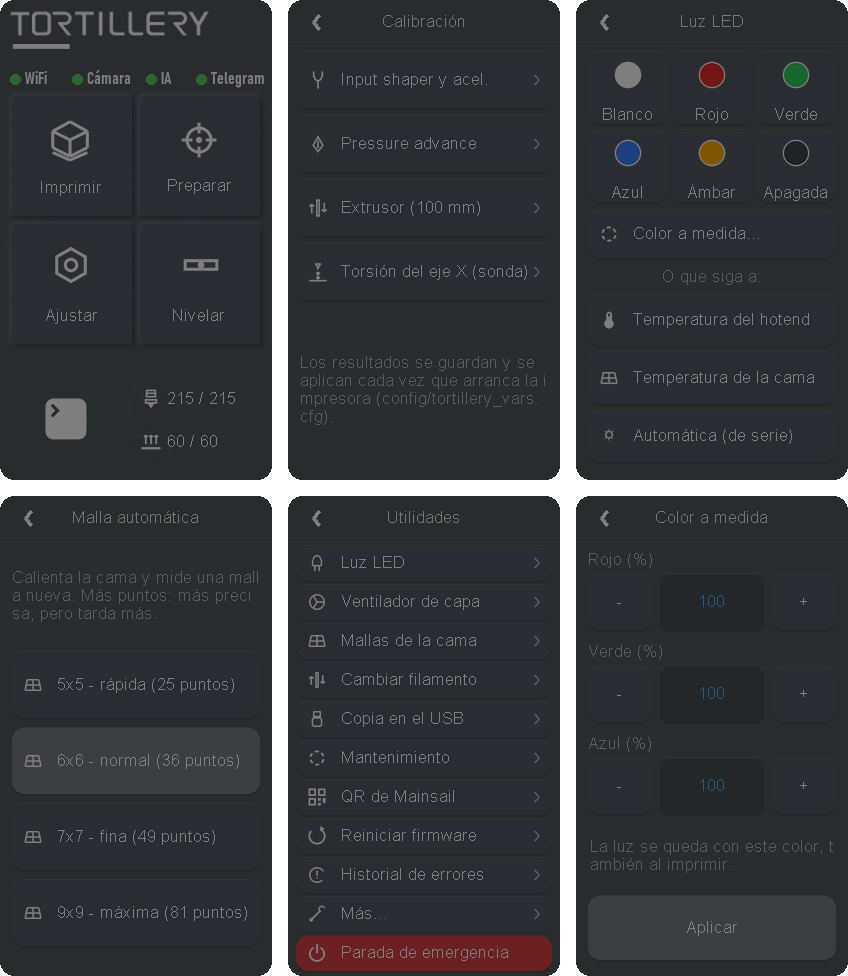
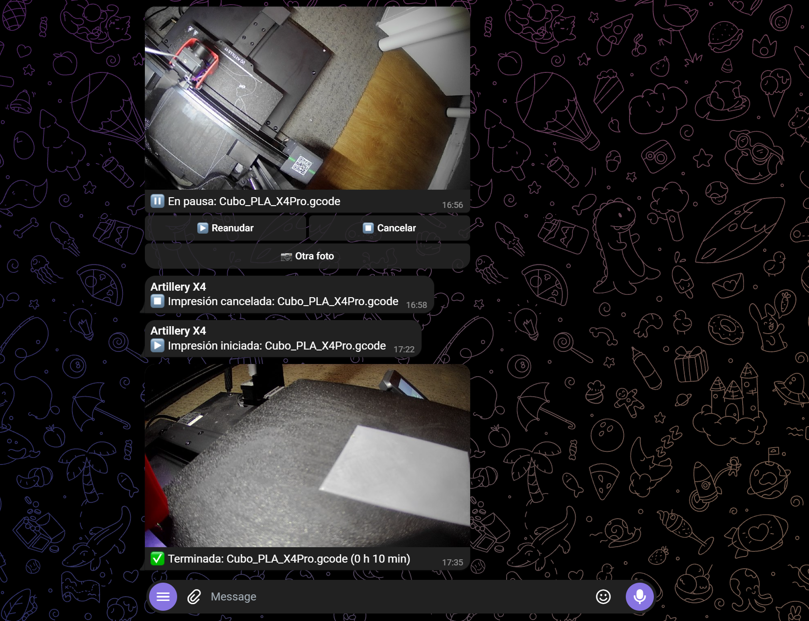
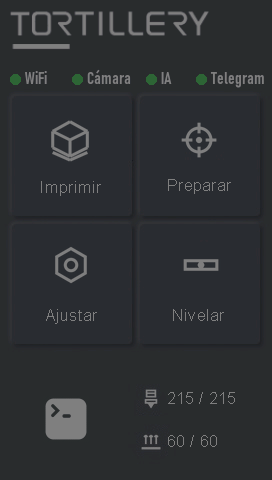

<div align="center">


# Tortillery+

**Klipper, Mainsail and a new touch screen for the Artillery Sidewinder X4 Pro and X4 Plus**

[](https://github.com/tecxion/tortillery-plus/tags)


[Download](#-download) · [Install](#-installation) · [SSH](#-connecting-over-ssh) · [FAQ](#-frequently-asked-questions) · [Troubleshooting](#-common-problems) · [Changes](../tortillery_plus/CAMBIOS.md) · [Full guide](../tortillery_plus/README.md) · [Customise](printer/README.md) · [Examples](../ejemplos/README.md) · [Telegram](telegram/README.md) · [🇪🇸 Español](../README.md)

</div>

---

> [!NOTE]
> This is the English translation of the main README. The screen works in English and Spanish (you choose on first
> boot). Telegram messages, macro names (`PRUEBA_HOMING`, `CALIBRAR_ESCUADRA`…) and the rest of the documentation
> ([full guide](../tortillery_plus/README.md), [changes](../tortillery_plus/CAMBIOS.md)) are in Spanish, except
> [customising the printer](printer/README.md).

Flash the image, switch the printer on and the screen guides you: **model, language, WiFi and bed levelling**. No SSH,
no editing files, and your calibration is kept on every update.

## ✨ What you get

|                          |                                                                                                                           |
| ------------------------ | ------------------------------------------------------------------------------------------------------------------------- |
| 🖥️ **New screen**        | WiFi from the screen, folder browser with USB, real remaining time, readable errors and guided calibration.              |
| 🎯 **Guided calibration** | Input shaper with maximum acceleration, pressure advance per material, extruder, X-axis twist and X/Y skew.               |
| ⚡ **Power loss**        | Saves the state every 5 s and offers to resume the print when power comes back.                                          |
| 📷 **Automatic camera**  | Any USB webcam shows up in Mainsail without configuring anything.                                                         |
| 🤖 **AI monitoring**     | Detects spaghetti, detached parts, clogs, blobs on the nozzle and layer shifts; pauses, sends a photo and marks it in Mainsail. |
| 💬 **Telegram**          | Start, pause with buttons, finish with photo, timelapse video and maintenance reminder. `/foto`, `/estado`, `/reanudar`.  |
| 🔄 **Updates**           | One click from Mainsail (stable, signed versions only, never while printing) and signed USB for screen and board.         |
| 🛡️ **Safer**             | Heaters off on long pauses, loose thermistor detection, watchdog and automatic config backups.                            |

Full list of changes compared with the original Tortillery: **[CAMBIOS.md](../tortillery_plus/CAMBIOS.md)** (Spanish).

## 🆕 What's new in 1.1.5 (beta)

**Screen and printing**
- 🛑 **Emergency stop** on the printing screen: red button at the top left, with confirmation.
- 🧵 **Out of filament**: the printer used to stop silently with the head over the part. Now it warns on the screen and
  on Telegram. _Accept_ moves the head to the left (the bed does not move, so no position is lost) and opens _Load
  filament_: Unload and Load 10, 50 or 100 mm, then _Resume_. Temperatures never drop on their own during that pause;
  the nozzle only turns off if you press _Enfriar_ (cool down) on Telegram. It will not resume while the sensor still
  sees no filament.
- 🔁 **Filament change (M600)**: opens the same _Load filament_ page at the print temperature (it used to heat to the
  temperature of the selected material).
- 🚫 **Won't start without filament**: with the sensor enabled and no filament, `PRINT_START` stops with a message.
- 📏 **Purge stays on the bed**: calibration patterns purge in front of the pattern, and prints without object labels
  purge 8 mm further in than Artillery's line (on the edge it could fall off).
- 🏠 **Reliable X/Y homing**: at 20 mm/s with tuned sensitivity. `PRUEBA_HOMING` and `FIJAR_HOMING` make it exact for
  power-loss recovery.

**Calibration**
- Input shaper measured from 5 to 135 Hz (it stopped at 70 Hz and the X4's X resonance is around 100 Hz).
- Pressure advance per material: `PRINT_START MATERIAL=...` applies the one for PLA, PETG, ABS/ASA or TPU.
- X/Y skew with `CALIBRAR_ESCUADRA`.
- After a pattern, the head moves aside and the bed comes forward.

**AI and camera**
- 📐 **Mark your camera** at `http://tortilleryplus.local/ia`: from then on the AI looks only at the part, even as the
  bed and the head move.
- Also detects blobs on the nozzle and layer shifts, and looks at the part up close.
- If the photo is dark, it turns on the head light to take it.
- **ia** camera in Mainsail with the last photo it checked.

**System**
- 🌐 The printer is called **`tortilleryplus.local`** on the network: no need to look up its IP.
- ⏱️ Accurate print time (Klipper Estimator).
- 🛠️ **Your settings survive updates**: whatever you put in `config/ajustes/` overrides `printer.cfg`. How to do it:
  **[Customising the printer](printer/README.md)**, with [commented examples](../ejemplos/README.md).

## 📱 The screen

<div align="center">

</div>

<sub>Main menu with the status bar, guided calibration, LED light, mesh with 5x5 to 9x9 points, utilities and custom
colour.</sub>

## 💬 Telegram notifications

<table>
<tr>
<td width="55%">

</td>
<td>

The printer messages you on Telegram (messages are in Spanish):

- ▶️ **Start** and ⏹️ **cancel**, also when you cancel from the screen.
- ⏸️ **Pause with photo** and buttons: _Reanudar_ (resume), _Cancelar_ (cancel) and _Otra foto_ (another photo).
- ✅ **Finish with photo** and how long it took.
- ⚡ **Power loss**: when power comes back it tells you when it went, how far the print got, and lets you _Continuar_
  (continue) or _Descartar_ (discard).
- 🤖 If the AI sees a failure, it pauses and sends you the photo.
- 🧵 **Out of filament**: message with _Enfriar_ (cool down), _Reanudar_ and _Cancelar_; you load the new filament on
  the screen and temperatures stay up.
- 🎬 Timelapse video and maintenance reminder.

Commands: `/foto` (photo), `/estado` (status), `/reanudar` (resume), `/cancelar` (cancel), `/enfriar` (cool down),
`/continuar`, `/descartar` and `/ayuda` (help), also in the bot's **/** menu. It only obeys your chat.

**[Telegram guide](telegram/README.md)**: creating the bot, the token, the chat ID and the commands.

</td>
</tr>
</table>

## 🤖 AI monitoring

Every minute (or whatever you choose) the AI looks at the camera photo. If it sees a failure, it **pauses the print**
and sends you the photo.

- At the start of each print it finds the bed in the photo and only looks at that area, enlarged: **any camera
  position** works.
- **Mark your camera** at `http://tortilleryplus.local/ia`: the printer moves to 4 positions, you take a photo at each
  one and tap the nozzle and the bed corners. From then on the AI looks only at the part, enlarged, even as the bed and
  the head move, without spending requests looking for it. Works with the camera on the frame, on the bed or on the head.
- It compares each photo with one from a few minutes earlier, so it notices a part that has moved or growing spaghetti.
- Before pausing it can ask a second model to confirm.
- **Watch it live in Mainsail**: the **ia** camera shows the last photo checked with the part (green), the failure
  (red) and the verdict.
- Providers: Anthropic, OpenAI, Google, NVIDIA, Ollama (on your PC, free) or any OpenAI-compatible one.

Real example with a spaghetti photo (`tortillery-ai.py --test foto.jpg`):

```text
Proveedor nvidia, modelo nvidia/nemotron-3.5-super-vl-120b-a12b
{"fallo": true, "tipo": "espagueti", "confianza": 0.95,
 "motivo": "Exceso de filamento enredado alrededor del objeto impreso."}
```

`--test` also saves what the AI saw in `ia_prueba.jpg`, so you can check your camera framing. Set it up in
`tortillery_ai.cfg` from Mainsail: [how](../tortillery_plus/README.md#detección-de-fallos-con-ia-opcional) and
[all the options](printer/README.md#-ai-monitoring-tortillery_aicfg).

## ⚖️ Tortillery and Tortillery+

|                                                | Original Tortillery | **Tortillery+** |
| ---------------------------------------------- | :-----------------: | :-------------: |
| Klipper, Moonraker and Mainsail on the eMMC    |         ✅          |       ✅        |
| Install without SSH (on-screen wizard)         |          —          |       ✅        |
| Own SSH keys and identity per printer          |          —          |       ✅        |
| WiFi from the screen                           |          —          |       ✅        |
| Guided calibration (input shaper, PA…)         |          —          |       ✅        |
| 5x5 to 9x9 mesh and custom LED light           |          —          |       ✅        |
| AI monitoring and Telegram                     |          —          |       ✅        |
| Update from Mainsail (signed versions)         |          —          |       ✅        |
| Heaters off on long pauses                     |          —          |       ✅        |

## 📦 Download

The eMMC image and the screen firmware are too large for GitHub and are on Terabox:

> **[⬇️ Download Tortillery+ (Terabox)](https://1024terabox.com/s/1VxnkAWIMICElKzex2T21og)**

**Current version: 1.1.5 (beta).** The image ships Klipper 0.14.0, Moonraker 0.11.0 and Mainsail 2.19.0. Download the
`Tortillery+_1.1.5` folder: inside are the image (`IMAGEN_EMMC`) and the `USB` folder. What's new in each version:
[Changes](../tortillery_plus/CAMBIOS.md).

## 🧰 What you need

- An **Artillery Sidewinder X4 Pro or X4 Plus**.
- An **eMMC reader** (USB adapter for the board's eMMC module) to flash the image. Without one there's an advanced,
  risky method: [Installing without an adapter](Actualizar%20sin%20adaptador/README.md).
- A **FAT32 USB stick**, only to update the screen and the board firmware.
- Optional: a **USB webcam** (any UVC one) for photos, timelapse and the AI.
- Optional: an AI **API key** (or Ollama on your PC) and a **Telegram bot** created with
  [@BotFather](https://t.me/BotFather).

## 🚀 Installation



1. **Flash the image** to the printer's eMMC with [balenaEtcher](https://etcher.balena.io/) and let it verify.
2. **Switch the printer on.** The first boot takes a few minutes: it flashes the board and the screen by itself.
3. **On the screen**: choose X4 Pro or X4 Plus and the language.
4. **Welcome**: connect to WiFi, level the bed and press _Finish_.

To open Mainsail, type either of these in your browser:

- **`http://tortilleryplus.local`**: the printer's name on your network, nothing to look up.
- **`http://<printer IP>`**: the IP is shown on the welcome screen and in _Settings_. Use it if the name doesn't work
  (some old Android phones and some company networks can't resolve it).

> [!TIP]
> Already running the original Tortillery? You can update without reflashing the eMMC: see
> [the installation guide](../tortillery_plus/README.md).

## 🔄 Updating

- **From Mainsail**: _Machine › Update Manager › `tortillery`_. Updates configs, macros and KlipperLCD to the latest
  published version. Your calibration (PID, Z-offset, meshes, input shaper) is kept.
- **By USB, without internet**: see [Updating by USB](#-updating-by-usb-without-internet).

## 💾 Updating by USB (without internet)

The **[`USB`](../USB)** folder in this repository is the latest version (currently **1.1.5 beta**), signed. Use it to
update a printer that already runs Tortillery+ without internet: you only need your home network for step 4. (From the
original Tortillery the same folder works, with the steps in [the installation guide](../tortillery_plus/README.md#pasar-de-la-tortillery-original-a-tortillery-sin-grabar-la-emmc), in Spanish.)

1. Download the repository: green **Code › Download ZIP** button, then unzip it.
2. Copy **everything inside** the `USB` folder to the root of a FAT32 stick (the contents, not the folder).
   Optional: add `wifi.cfg` or `telegram.cfg` too ([examples](../ejemplos/usb)).
3. With the printer off, plug in the stick and switch it on. It flashes the board and the screen by itself (only if
   they changed) and the screen restarts. It takes a few minutes: don't switch it off.
4. Install configs, macros and screen. Over SSH (`ssh mks@<IP>`; `tortilleryplus.local` only if you already had 1.1.5 or later):

   ```bash
   sudo bash ~/printer_data/gcodes/USB/tortillery_plus/install.sh PRO     # or PLUS
   sudo reboot
   ```

   Your calibration (PID, Z-offset, meshes, input shaper) and the `ajustes` folder are kept.
5. Remove the stick.

> [!NOTE]
> The printer checks the signature (`SHA256SUMS.sig`) before flashing anything: if a file was changed or the copy is
> corrupt, it doesn't flash. It never updates while printing. What it did is logged in
> `journalctl -u tortillery-update` and `/var/log/tortillery-update.log`.

## 💻 Connecting over SSH

You don't need it to use the printer, but it's handy to read logs, restart services or install extras.

1. Open a terminal (on Windows, PowerShell already includes `ssh`; [PuTTY](https://www.putty.org/) works too).
2. Connect by the printer's name or by its IP (shown on the screen, in _Settings_):

   ```bash
   ssh mks@tortilleryplus.local
   ```

   ```bash
   ssh mks@<printer IP>
   ```

   The `tortilleryplus.local` name comes with 1.1.5: on an older version, use the IP.

3. User `mks`, password `makerbase`. The first time it asks whether you trust the printer: type `yes`.

> [!IMPORTANT]
> Change the password as soon as you log in with `passwd`, especially if you expose the printer to the internet.
> `root` cannot log in over SSH with a password: use `mks` and `sudo`.

### Useful commands

| What for                                    | Command                                                            |
| ------------------------------------------- | ------------------------------------------------------------------ |
| Show the IP                                 | `hostname -I`                                                      |
| Status of Klipper, Moonraker and the screen | `systemctl status klipper moonraker KlipperLCD`                    |
| Restart Klipper / the screen / Moonraker    | `sudo systemctl restart klipper` · `KlipperLCD` · `moonraker`      |
| Live Klipper log                            | `tail -f ~/printer_data/logs/klippy.log`                           |
| Screen log                                  | `journalctl -u KlipperLCD -f`                                      |
| AI and Telegram log                         | `journalctl -u tortillery-ai -f`                                   |
| Test the AI with the camera (or a photo)    | `python3 /usr/local/bin/tortillery-ai.py --test [foto.jpg]`        |
| Update log                                  | `journalctl -u tortillery-update -n 50`                            |
| Repair or reinstall Tortillery+             | `sudo bash ~/tortillery/tortillery_plus/install.sh PRO` (or `PLUS`)|
| Visible WiFi networks / network setup       | `nmcli device wifi list` · `sudo nmtui`                            |
| Free space                                  | `df -h /`                                                          |
| Reboot / power off                          | `sudo reboot` · `sudo poweroff`                                    |

**Optional extras** (installed one by one; running them again only updates them). The image ships with no extras
installed: `config/extras/` stays empty until you install one that uses macros (timelapse or Shake&Tune).

```bash
sudo bash ~/tortillery/tortillery_plus/extras.sh tailscale   # Mainsail and SSH from outside your home
bash ~/tortillery/tortillery_plus/extras.sh octoeverywhere    # remote access and notifications from the app
sudo bash ~/tortillery/tortillery_plus/extras.sh timelapse   # a video of every print (needs a camera)
bash ~/tortillery/tortillery_plus/extras.sh shaketune         # belt and vibration graphs
bash ~/tortillery/tortillery_plus/extras.sh mobileraker       # push notifications on your phone
```

> [!CAUTION]
> Don't power off or reboot while printing, and don't edit `printer.cfg` over SSH with a print running.

## ❓ Frequently asked questions

<details>
<summary><b>Do I lose my calibration when updating?</b></summary>

No. The installer keeps the `SAVE_CONFIG` block of `printer.cfg` (PID, Z-offset, meshes, input shaper) and
`tortillery_vars.cfg` (pressure advance, acceleration, extruder), and saves an `.orig` copy of every file it replaces.
Changes you make by hand in `printer.cfg` **are lost**: put them in `config/ajustes/` instead
([how](printer/README.md)).

</details>

<details>
<summary><b>Does the AI cost money?</b></summary>

It depends on the provider. With **Ollama** on your PC it's free. NVIDIA gives free credits to start. Anthropic, OpenAI
and Google charge per use; to save money, the AI doesn't send repeated photos and only watches while printing.

</details>

<details>
<summary><b>Do I need a camera?</b></summary>

Only for the AI, the Telegram photos and the timelapse. Everything else works without a camera.

</details>

<details>
<summary><b>Can I use the same Telegram bot on two printers?</b></summary>

No. Telegram only lets one program read each bot's messages. Create **one bot per printer** with @BotFather.

</details>

<details>
<summary><b>Can I go back to the original Tortillery or the Artillery firmware?</b></summary>

Yes: flash whichever image you want to the eMMC, the same way you flashed this one. Before that, save a copy of your
`printer.cfg` from Mainsail.

</details>

<details>
<summary><b>Which version do I have?</b></summary>

On the screen: _Settings › Information_. In Mainsail: _Machine › Update Manager › `tortillery`_. If it's older than
1.1.4, update from Mainsail (press ↻ if it doesn't show yet).

</details>

## 🔧 Common problems

> [!WARNING]
> Many frozen screens are fixed by switching the printer off and on again.

| What you see                                                | What to do                                                                                                                                                                                                                                  |
| ----------------------------------------------------------- | ------------------------------------------------------------------------------------------------------------------------------------------------------------------------------------------------------------------------------------------- |
| The screen doesn't respond or stays on the logo             | Wait for the first boot (several minutes). If it stays the same, over SSH: `sudo systemctl restart KlipperLCD`. If not, flash the `USB` folder from the download again.                                                                     |
| Klipper error on the screen                                 | The screen shows the reason; press _Firmware restart_. The details are in Mainsail › _Machine_ › `klippy.log`.                                                                                                                              |
| Mainsail shows `tortillery` as **INVALID**                  | Happens on printers with 1.0.1. Over SSH: `sudo bash ~/tortillery/tortillery_plus/install.sh PRO` (or `PLUS`). Fixed since 1.1.0.                                                                                                           |
| Telegram: `409 Conflict` in the log                         | Another program uses the same bot (another printer, another script). Use one bot per printer.                                                                                                                                               |
| The AI doesn't detect failures                              | Test with `python3 /usr/local/bin/tortillery-ai.py --test` and look at `config/ia_prueba.jpg`: if the bed isn't visible, move the camera, mark it at `/ia` or set `recorte:` by hand in `tortillery_ai.cfg`. Log: `journalctl -u tortillery-ai -f`. |
| The AI pauses for no reason                                 | Raise `umbral:` or `confirmaciones:` in `tortillery_ai.cfg`, or set a `modelo_confirmar:`.                                                                                                                                                  |
| The USB stick doesn't show up                               | Format it as FAT32 (or ext4). It appears in Mainsail and on the screen inside the `USB` folder.                                                                                                                                            |
| After resuming from a power loss, the part is shifted in X/Y | It's the homing without endstops. In the Mainsail console: `PRUEBA_HOMING` and, if it varies 0.30 mm or less, `FIJAR_HOMING`. [More details](../tortillery_plus/README.md#homing-exacto-de-xy-recomendado-para-la-recuperación-tras-corte-de-luz). |
| Homing hits the end, sounds like skipping teeth or stops early | Homing sensitivity is wrong for your printer. [Tuning guide](../tortillery_plus/README.md#homing-exacto-de-xy-recomendado-para-la-recuperación-tras-corte-de-luz). |
| A print won't start: "Sin filamento"                        | The filament sensor sees no filament. Load filament, or turn the sensor off for that print: `SET_FILAMENT_SENSOR SENSOR=fila ENABLE=0`.                                                                                                    |
| WiFi: wrong password                                        | Connect again from _Settings › WiFi_; other saved networks are kept.                                                                                                                                                                        |
| The Mainsail update doesn't install                         | Only signed versions install, and never while printing. Check `journalctl -u tortillery-update`.                                                                                                                                            |

## 🆘 Help and contact

Something not working, or got an idea? Open an **[issue on GitHub](https://github.com/tecxion/tortillery-plus/issues)**
(English is fine) and include:

- Model (X4 Pro or X4 Plus) and Tortillery+ version.
- What you did, what you expected and what happened (a photo of the screen helps a lot).
- The logs: `klippy.log` and `moonraker.log` (Mainsail › _Machine_) and, for the AI, `journalctl -u tortillery-ai -n 100`.

> [!WARNING]
> Before pasting a log or a config file, **remove your keys**: the Telegram token and the AI API keys.

### 🎮 Also on Discord

- If you use Discord you can ask there too: there's a Tortillery+ forum on my server.

[DISCORD](https://discord.gg/QAbVYzxPKk)

## 📁 What's in this repository

```
tortillery_plus/   Klipper configs, installer, scripts, AI, Telegram and services
plr/               power-loss recovery and KlipperLCD (screen)
printer/           guide to customising printer.cfg, moonraker.conf, the AI and Telegram
telegram/          Telegram guide (Spanish; English in Traducido/telegram)
Actualizar sin adaptador/  installing without an eMMC reader (advanced method, by Mustafa Yücel)
ejemplos/          commented example files, Spanish and English (settings, AI, Telegram, Moonraker, camera, slicer)
USB/               offline update stick (latest version, signed)
Traducido/         this README and the customising guide in English
assets/            README images
```

## 🙏 Thanks

- **[CiareCw455/Tortillery](https://github.com/CiareCw455/Tortillery)** — the original Tortillery, where the idea came
  from, and the Tortillery v0.5.2 screen `.HMI` project that the Tortillery+ screen is built on. Thank you!
- **[joakimtoe/KlipperLCD](https://github.com/joakimtoe/KlipperLCD)** (Apache-2.0) — the program that connects the
  screen to Klipper. The modified files are in `plr/KlipperLCD/` with their licence.
- **JeroMod** and **Tortillery 2.0** (@UrtziDV) — ideas incorporated.
- [Klipper](https://github.com/Klipper3d/klipper), [Moonraker](https://github.com/Arksine/moonraker),
  [Mainsail](https://github.com/mainsail-crew/mainsail), Crowsnest, KAMP, Shake&Tune, Moonraker-Timelapse, Mobileraker and
  Armbian.

## 📜 Licence

This project includes components under the following licences:

- GPL-2.0 or later (armbian-mkspi)
- Apache-2.0 (KlipperLCD)

For compatibility, Tortillery+ as a whole is licensed under [GPL-3.0](https://www.gnu.org/licenses/gpl-3.0.html).

### 💰 Want to support my work?

If you like what I do and want to help me keep growing and creating content:

<div align="center">
<p align="center">
  <a href="https://paypal.me/jfmpkiko">
    
  </a>
  &nbsp;&nbsp;
  <a href="https://coff.ee/tecxart">
    
  </a>
</p>

<p align="center">
  
  &nbsp;
  
  &nbsp;
</p>
</div>

<div align="center">
<sub>Made in Spain 🇪🇸 for the Artillery X4 community</sub>
</div>
